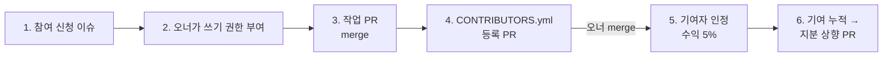

# 🤝 공동제작 참여 가이드

> 다른 멤버의 게임을 같이 만들고 싶나요? **PR로 기여자 설정을 바꿔 보내면 됩니다.**
> 기여자로 인정되는 순간 그 게임 수익의 **5%** 가 제안됩니다.



## 1. 참여 신청

같이 만들고 싶은 레포에 **🤝 공동제작 참여 신청** 이슈를 엽니다. 양식이 아래를 묻습니다.

- 맡고 싶은 일 (프로그래밍, 맵, 모델링, 애니메이션, 사운드, UI, 기획 …)
- 보여 줄 수 있는 작업물 (다른 레포, 로블록스 게임, 포트폴리오)
- Roblox 프로필 링크
- 일주일에 쓸 수 있는 시간

조직 밖에 있다면 먼저 [소통창구](https://github.com/sickBoyStudio/.github/discussions)의 **🤝 팀원 모집** 글에 댓글을 달거나 자기소개를 올려 주세요.

## 2. 오너가 받아 주면

오너가 레포 **Settings → Collaborators and teams**에서 여러분에게 **Write** 권한을 줍니다. 이제 브랜치를 만들고 PR을 보낼 수 있습니다.

## 3. 작업하고 PR 보내기

```sh
git switch -c feat/내-작업
# 작업
git commit -m "보스 방 조명 추가"
git push -u origin feat/내-작업
gh pr create
```

- `main`에 직접 푸시하지 않습니다.
- 외부 에셋을 썼다면 `CREDITS.md`에 출처와 라이선스를 적습니다.
- 오타 수정이나 포맷 정리만으로는 기여자로 인정되지 않습니다. 게임에 실제로 들어가는 작업이어야 합니다.

## 4. 기여자 등록 PR — 여기서 5%가 결정됩니다

작업 PR이 1개 이상 merge되면, 레포 루트의 `CONTRIBUTORS.yml`에 **본인 항목을 추가**하는 PR을 보냅니다.

```yaml
contributors:
  - github: 내-깃허브-아이디
    roblox_user_id: 123456789
    role: 맵 — B1 연구동
    share: 5
    status: active
    recognized_at: 2026-10-20    # 오너가 merge할 날짜로 적습니다 (오너가 고칠 수 있음)
    agreement: v1.0
    contributions:
      - "#12"
    history:
      - { date: 2026-10-20, share: 5, reason: 첫 기여자 인정 }
```

PR 본문에는 반드시 아래 동의 문구를 적습니다. ([기여자 약정 v1.0](policies/contributor-agreement.md) 전문)

```
저는 sickBoyStudio 기여자 약정 v1.0과 수익 분배 규칙 v1.0을 읽었고 동의합니다.
```

**자동 검사**가 PR에서 확인하는 것

- 첫 등록의 `share`가 5인지
- 다른 사람 항목이나 `owner`, `project`를 건드리지 않았는지
- 기여자 지분 합계가 상한(기본 50%)을 넘지 않는지
- `history`의 마지막 값이 현재 `share`와 같은지

**오너가 merge하면** 그 순간 기여자로 인정되고, 게임 수익의 5%가 확정됩니다. 오너는 7일 안에 Roblox 그룹의 게임별 분배에 여러분을 추가합니다(출시 전이면 출시할 때).

## 5. 지분 올리기

기여가 쌓이면 같은 방식으로 PR을 보냅니다.

```yaml
    share: 10
    contributions:
      - "#12"
      - "#31"
      - "#44"
    history:
      - { date: 2026-10-20, share: 5, reason: 첫 기여자 인정 }
      - { date: 2027-01-05, share: 10, reason: 전투 시스템 전담 (60일+) }
```

- 직접 올릴 수 있는 폭은 **한 번에 +5%p** 입니다.
- 기준표(기여자 5% → 주요 기여자 최대 10% → 공동 오너 협의)는 [수익 분배 규칙 4장](policies/revenue-share.md#4-그-다음--지분-상향).
- 오너가 merge하면 **다음 달 1일**부터 적용됩니다.

## 6. 떠날 때

본인 항목을 지우지 말고 `status: left`로 바꾸는 PR을 보냅니다. 지분이 어떻게 되는지는 [수익 분배 규칙 6장](policies/revenue-share.md#6-지분이-줄거나-사라지는-경우).

## 7. 오너라면

- [ ] 레포에 [`CONTRIBUTORS.yml`](templates/CONTRIBUTORS.yml), [`LICENSE`](templates/LICENSE), [`CREDITS.md`](templates/CREDITS.md), [검사 워크플로](templates/workflows/contributors-check.yml)를 넣었다
- [ ] 같이 만들 게임은 내 **Roblox 그룹**으로 퍼블리시한다
- [ ] 기여자 등록 PR을 merge하면 7일 안에 그룹의 게임별 분배를 맞춘다
- [ ] 출시 후 매달 수익과 분배 내역을 레포에 공유한다
- [ ] 기여자 지분을 낮춰야 하면 이슈로 알리고 7일 소명 기간을 준다
