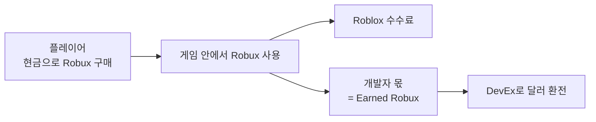

# 📈 로블록스 수익구조 (2026년 10월 기준)

> 마지막 확인: **2026-10-15**. Roblox는 수익 정책을 자주 바꿉니다. 숫자를 근거로 결정하기 전에 맨 아래 공식 출처를 다시 확인하세요.
> 바뀐 것을 발견하면 이 문서에 PR을 보내 주세요.

## 1. 한눈에 보기

플레이어가 쓴 **1달러 중 개발자 손에 실제로 남는 돈은 대략 26.6센트**입니다.
(Robux 1개를 약 1센트에 샀다고 보고, 게임 안 판매의 70%를 받고, 그것을 개당 $0.0038에 환전하면 0.70 × 0.38 ≈ 0.266)
미국의 18세 이상 인증 플레이어가 쓴 돈은 같은 계산으로 **약 37.8센트**입니다(아래 4장).

## 2. 게임 안에서 버는 방법과 개발자 몫

| 수익원 | 개발자 몫 | 메모 |
|---|---|---|
| **게임 패스** (한 번 사면 영구) | 판매가의 **70%** | Roblox 마켓 수수료 30%. 100 Robux 패스 → 70 Robux |
| **개발자 상품** (반복 구매: 재화, 부활 등) | 판매가의 **70%** | 패스와 같음 |
| **구독** — Robux 가격 | 매달 **70%** | 최소 49 Robux. 약 5일 보류 후 입금 |
| **구독** — 현지 통화 가격 | 첫 달 **70%**, 둘째 달부터 **100%** (스토어 수수료 뺀 기준가 기준) | $2.99 / $4.99 / $7.99 / $9.99 / $14.99 중 선택. 30일 보류. 예: $5 구독 → 첫 달 350, 이후 매달 500 Robux |
| **비공개 서버** (월 결제) | 판매가의 약 **70%** | 구독 중인 서버는 **구매 시점의 그룹 분배 비율**이 해지될 때까지 유지 |
| **유료 입장** (Robux 또는 현지 통화) | — | ⚠️ **현지 통화 유료 입장 게임은 그룹 멤버에게 수익을 나눌 수 없습니다.** 공동제작 게임이라면 피하세요 |
| **아바타 아이템 게임 내 판매** | 게임 오너 **40%** 커미션 | 아이템 제작자 몫(30%)과 별개로, 판매가 일어난 게임의 오너가 받음 |
| **몰입형 광고** | 노출에 따라 | 게임에 광고판을 두면 광고 수익 |
| **Roblox Plus 인센티브** | Roblox가 산정 | 구독자 유입·참여에 따른 보상 |

## 3. Creator Rewards — 판매 없이 받는 보상

2025년 7월 24일부터 기존 Premium Payouts 대신 시행 중입니다. 신청할 필요 없이 자동이며, **60일 보류** 후 Earned Robux로 들어옵니다.

| 보상 | 조건 | 금액 |
|---|---|---|
| **일일 참여 보상** | "Active Spender"(최근 60일 동안 $9.99 이상 결제한 기존 유저)가 그날 **처음 실행한 3개 게임 중 하나**로 우리 게임에서 **10분 이상** 플레이 | 유저 1명당 하루 **5 Robux** |
| **오디언스 확장 보상** | 신규·복귀 유저가 **공유 링크, 직접 링크, 게임 이름 검색**으로 들어와 그날 10분 이상 플레이. 게임의 60일 평균 DAU가 100 이상. 오너 계정 신분증 인증 필요 | 그 유저가 첫 60일 동안 Roblox 전체에서 결제한 금액 중 **첫 $100의 35%** (유저 1명당 1회) |

💡 **입문자에게 중요한 포인트**: 친구에게 게임 링크를 직접 공유해서 데려오는 것만으로도 보상이 생길 수 있습니다. 공유 링크를 적극적으로 쓰세요.

## 4. DevEx — Robux를 현금으로

| 항목 | 내용 |
|---|---|
| **일반 환율** | **$0.0038 / Robux** — 2025년 9월 5일 오전 10시(PT) 이후에 번 Robux |
| 이전 환율 | $0.0035 / Robux — 그 이전에 번 Robux. **이것부터 먼저** 환전됩니다 |
| **미국 18세 이상 환율** | **$0.0054 / Robux** — 2026년 6월 8일부터. 얼굴 연령 추정이나 신분증으로 18세 이상이 확인된 **미국** 플레이어가 산 개발자 상품·패스·구독·비공개 서버. 대상 게임은 **R15 아바타**를 써야 합니다 |
| **최소 금액** | **30,000 Earned Robux** (일반 환율로 약 $114) |
| 신청 횟수 | **한 달에 1번**. 제출하면 취소 불가 |
| 처리 기간 | 처음 약 10영업일, 이후 약 5영업일 (+ 은행 송금 시간) |
| 자격 | 만 13세 이상, 이메일 인증, DevEx 포털 계정, 세금 양식(미국인이 아니면 W-8), 이용약관·커뮤니티 규칙 준수 |
| 지급 | DevEx 포털(Tipalti)을 통해 은행 계좌로. 첫 승인 후 1주일 안에 지급 방법과 세금 양식을 등록하지 않으면 거절·환불 |

**Earned Robux로 인정되는 것**: 게임 내 판매, 마켓 수수료, 유료 비공개 서버, 유료 입장, Roblox Plus 인센티브, 광고, Creator Store 판매, 아바타 아이템 판매, Creator Rewards, 그리고 **정상적으로 번 돈에서 나온 그룹 분배**.

**인정되지 않는 것**: 직접 산 Robux, 월 구독으로 받은 Robux, 트레이드·리셀, 남에게 받은 Robux, 기프트카드, 방문이 없는 템플릿 게임의 패스 판매, 규칙 위반 콘텐츠로 번 Robux.

## 5. 그룹 수익과 분배 — 우리 조직이 쓰는 기능

| 기능 | 내용 |
|---|---|
| **일회성 지급** | 멤버에게 정해진 Robux를 한 번에 지급. CSV(`userId`, `payoutInRobux`)로 한 번에 20명까지. **되돌릴 수 없음** |
| **정기 분배 — 게임별** | 게임 하나의 수익을 멤버별 퍼센트로 자동 분배. **우리 조직의 기본 정산 방법** |
| **정기 분배 — 그룹 전체** | 게임별 분배를 하고 남은 금액에서 다시 퍼센트로 분배 |
| 순서 | 게임별 분배 → 남은 금액에 그룹 전체 분배 → 그래도 남은 금액은 그룹 잔고 |
| 권한 | "그룹 수익 관리·사용" 권한이 필요하고, 이 권한에는 Roblox **2단계 인증**이 필수 |
| 제한 | 새 그룹이나 잔고가 적은 그룹은 분배 메뉴가 바로 열리지 않을 수 있음. 그룹 생성 100 Robux |

**계산 예** (Roblox 공식 예시): 게임 A를 40% / 30% / 10%로 게임별 분배하고, 그룹 전체 분배가 20% / 20% / 10%일 때 1,000 Robux가 들어오면
→ 게임별로 400 / 300 / 100, 남은 200에서 그룹 전체로 40 / 40 / 20, 마지막 100은 그룹 잔고.

## 6. 게임 밖에서 버는 방법

| 수익원 | 개발자 몫 |
|---|---|
| **아바타 아이템**(3D UGC, 2D 옷 포함) 마켓 판매 | 기본 **30%**. 아이템 종류별 최저가의 몇 배로 파느냐에 따라 최대 **70%**까지 올라감 (2배 50%, 3배 62%, 6배 이상 70%) |
| 아바타 아이템 게임 내 판매 | 제작자 30% + 판매가 일어난 게임 오너 40% |
| 아이템 업로드 비용 | 업로드 수수료 80 Robux + 종류별 퍼블리싱 선급금(나중에 수수료 환급으로 회수) |
| **Creator Store**(모델, 플러그인) | 세금·결제 수수료만 빼고 지급. 최소가 모델 $2.99, 플러그인 $4.99. 판매마다 30일 보류 |

## 7. 입문자가 자주 틀리는 것

- 🚫 **Robux를 현금으로 사고팔면 안 됩니다.** 이용약관 위반이고 계정이 정지될 수 있습니다. 팀원 정산은 그룹 분배로만 하세요.
- 🚫 **산 Robux는 DevEx가 안 됩니다.** 남에게 받은 Robux도 마찬가지입니다.
- ⏳ **보류 기간**이 있습니다. 판매 수익은 며칠, Creator Rewards는 60일 뒤에 들어옵니다.
- 💸 **DevEx 최소 30,000 Robux**. 작은 팀이라면 몇 달 모아서 환전하게 됩니다.
- 🧾 **세금은 각자 신고합니다.** [법적 구조와 세금](../policies/legal-structure.md#5-세금) 참고.

## 출처 (공식)

- [Developer Exchange — Creator Hub](https://create.roblox.com/docs/production/monetization/developer-exchange)
- [Developer Exchange 도움말 — Roblox Support](https://en.help.roblox.com/hc/en-us/articles/13061189551124-Developer-Exchange-Help-and-Information-Page)
- [Introducing the US 18+ DevEx Rate — DevForum](https://devforum.roblox.com/t/introducing-the-us-18-devex-rate-earn-42-more-on-spend-from-18-us-players/4607091) · [Roblox 뉴스룸 (2026-04)](https://about.roblox.com/newsroom/2026/04/roblox-fuels-high-fidelity-games-over-18-players-increases-qualifying-devex-rate-42)
- [Creator Rewards — Creator Hub](https://create.roblox.com/docs/creator-rewards)
- [Groups(그룹 수익·분배) — Creator Hub](https://create.roblox.com/docs/projects/groups) · [그룹 수익 관리 개선 발표 (2025-12) — DevForum](https://devforum.roblox.com/t/managing-your-group-revenue-and-experience-ownerships-just-became-a-lot-easier/4114133)
- [Subscriptions — Creator Hub](https://create.roblox.com/docs/production/monetization/subscriptions)
- [Marketplace fees and commissions — Creator Hub](https://create.roblox.com/docs/marketplace/marketplace-fees-and-commissions)
- [Monetization 개요 — Creator Hub](https://create.roblox.com/docs/production/monetization)
- 미국 18+ 개발자 실수령 비율 26.6% → 37.8%: [Roblox 2026년 2분기 실적 자료 (SEC 8-K)](https://www.sec.gov/Archives/edgar/data/0001315098/000162828026051059/ex991-robloxq22026earnin.htm)
