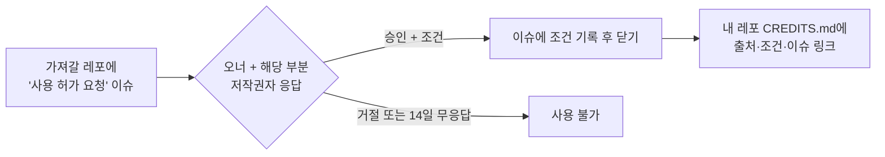

# 🔒 저작권과 코드·에셋 사용 허가

> **열람은 자유, 가져가기는 허락.**
> 조직 멤버는 모든 레포를 볼 수 있습니다. 하지만 볼 수 있다는 것이 가져다 써도 된다는 뜻은 아닙니다.

## 1. 누가 저작권을 가지나

| 대상 | 저작권자 |
|---|---|
| 레포의 코드·에셋 | 그것을 만든 사람. 오너가 만들었으면 오너, 기여자가 만들었으면 그 기여자 |
| 여러 사람이 섞어 만들어 떼어 쓸 수 없는 부분 | 만든 사람들의 **공동저작물**. 권리 행사는 [기여자 약정](contributor-agreement.md) 제3조에 따라 오너가 대표 |
| 외부 에셋(무료 모델, 오픈소스, 구매 에셋) | 원래 제작자. 각 라이선스를 따름 → `CREDITS.md`에 기록 |
| 이 `.github` 레포의 규칙 문서 | sickBoyStudio 멤버 공동 |

- **조직(sickBoyStudio)은 어떤 게임의 저작권도 갖지 않습니다.**
- 모든 게임 레포는 기본적으로 **All Rights Reserved**입니다. 오픈소스 라이선스를 붙이지 않는 한, 허락 없이 복제·수정·배포할 수 없습니다. 레포에 [`LICENSE` 템플릿](../templates/LICENSE)을 넣어 두세요.
- 레포가 공개(public)로 바뀌어도 마찬가지입니다. 공개 ≠ 사용 허락.

## 2. 허락 없이 해도 되는 것 (참고)

- 다른 레포의 코드와 에셋을 **읽고, 실행해 보고, 배우는 것**
- 거기서 배운 **아이디어, 구조, 패턴, 알고리즘의 원리**를 자기 방식으로 다시 구현하는 것 (아이디어 자체는 저작권 보호 대상이 아닙니다)
- 리뷰나 질문을 위해 **짧게 인용**하고 출처(레포·파일·커밋 링크)를 다는 것

## 3. 허락이 필요한 것 (가져가기)

- 코드를 **복사해서** 다른 레포나 다른 게임에 넣는 것 (수정해서 넣어도 마찬가지)
- 모델, 맵, 애니메이션, 텍스처, 사운드, UI 이미지를 **다른 게임에서 쓰는 것**
- place 파일(`.rbxl`, `.rbxlx`)이나 패키지를 **통째로 복제**하는 것
- 캐릭터, 세계관, 이름, 로고를 **다른 작품에 쓰는 것**

## 4. 허락 받는 방법

1. 가져가고 싶은 레포에 **🔑 코드·에셋 사용 허가 요청** 이슈를 엽니다. 이슈 양식이 아래를 묻습니다.
   - 무엇을: 파일 경로와 **커밋 해시**(버전 고정)
   - 어디에: 쓸 레포와 게임
   - 왜·어떻게: 그대로/수정해서, 상업적 사용 여부
   - 제안하는 조건
2. **승인할 사람**: 그 레포의 **오너**, 그리고 그 부분을 만든 **기여자**(있다면). `git blame`이나 커밋 기록으로 확인합니다.
3. 승인은 이슈에 댓글로 **"승인합니다 — 조건: ..."** 처럼 분명하게 남깁니다. 이모지 반응은 승인으로 보지 않습니다.
4. **14일 동안 답이 없으면 거절**로 봅니다. 묵시적 허락은 없습니다.
5. 승인되면 가져간 쪽 레포의 `CREDITS.md`에 출처, 커밋, 조건, 허가 이슈 링크를 적습니다.

### 조건은 이 중에서 고르거나 섞습니다

| 조건 | 예 |
|---|---|
| 무상 + 크레딧 | "게임 크레딧과 CREDITS.md에 이름 표시" |
| 수익 지분 | 가져간 게임에서 원저작자를 기여자로 등록 (보통 2.5~5%) |
| 일회성 대가 | Roblox 그룹 일회성 지급으로 Robux 지급 |
| 범위 제한 | "비상업 테스트에만", "이 게임 한 개에만", "수정 금지" |

### 조직 밖 사람이 요청할 때

- 비공개 레포는 밖에서 볼 수 없으므로, 소통창구에 글을 올리거나 오너에게 직접 연락해 같은 내용을 보냅니다.
- 오너는 같은 기준으로 판단하고, 결과를 레포 이슈에 기록합니다.

## 5. 공용으로 내놓고 싶을 때

여러 게임에서 같이 쓰면 좋은 범용 모듈은 오너가 원할 때 조직 공용 레포로 기부할 수 있습니다. 공용 레포의 라이선스와 규칙은 만들 때 이 문서에 추가합니다.

## 6. 외부 에셋을 쓸 때 (모두에게 해당)

- Roblox Creator Store(툴박스) 에셋, 오픈소스, 구매 에셋, AI 생성물은 **출처와 라이선스를 `CREDITS.md`에** 적습니다. ([템플릿](../templates/CREDITS.md))
- 음악·효과음은 **라이선스가 확인된 것만** 씁니다. 상업 음원을 무단으로 올리면 Roblox에서 삭제되고 계정이 제재될 수 있습니다.
- 무료 모델에는 악성 스크립트(백도어)가 숨어 있는 경우가 많습니다. 넣기 전에 안에 든 Script를 전부 확인하세요.

## 7. 어기면

허락 없이 가져가는 것은 저작권 침해입니다. [저작권 침해 대응](infringement-response.md) 절차로 처리하며, 기여자라면 [수익 분배 규칙](revenue-share.md) 6장의 박탈 사유가 될 수 있습니다.
