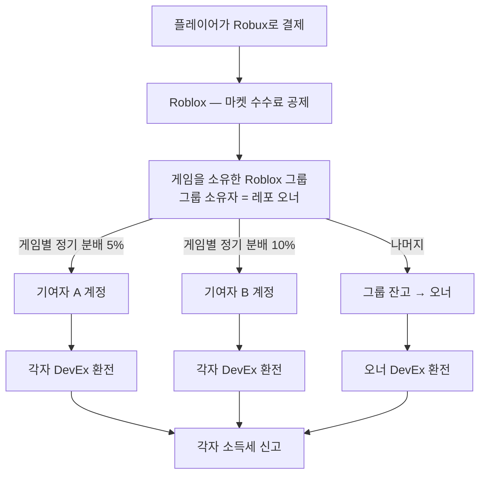

# ⚖️ 법적 구조와 세금

> ⚠️ 이 문서는 조직이 어떻게 굴러가도록 설계했는지 설명하는 것이며 **법률·세무 자문이 아닙니다.**
> 실제 수익이 생기면 각자 세무사에게, 큰 계약 전에는 변호사에게 확인하세요.

## 1. sickBoyStudio는 무엇인가

- **법인이 아닌 협업 조직**입니다. 실체는 GitHub Organization과 공동 규칙(이 레포)입니다.
- 조직은 **돈을 받지도, 주지도 않습니다.** 조직 명의 계좌나 조직 Roblox 그룹 잔고로 게임 수익을 모으지 않습니다.
- 계약의 당사자는 언제나 **사람과 사람**입니다. 게임마다 **오너 ↔ 기여자** 사이에 [기여자 약정](contributor-agreement.md)이 성립합니다.

## 2. 왜 이렇게 시작하나

| 장점 | 한계 |
|---|---|
| 설립 비용, 장부, 법인 회계 의무가 없음 | 조직 이름으로 계약(퍼블리셔, 외주, 투자)을 맺을 수 없음 |
| 각자 자기 몫의 세금만 신경 쓰면 됨 | 게임별로 정산이 따로따로 |
| Roblox 그룹 분배 기능으로 정산이 자동 | Roblox 정책이 바뀌면 같이 영향을 받음 |
| 누구나 레포를 만들어 바로 오너가 될 수 있음 | 오너 한 사람에게 게임 운영 권한이 몰림 → 기록과 규칙으로 보완 |

## 3. 돈의 흐름

- 그룹 분배로 받은 Robux도, 그룹이 정상적으로 번 돈이라면 **Earned Robux**로 인정되어 각자 DevEx로 환전할 수 있습니다. ([Roblox DevEx 문서](https://create.roblox.com/docs/production/monetization/developer-exchange))
- 게임별 분배를 하고 남은 Robux는 그룹 잔고에 쌓입니다. 오너는 일회성 지급으로 자기 계정에 옮기거나, 그룹 전체 분배에 자기를 넣어 받습니다.
- 그래서 **누구도 남의 돈을 대신 받아서 다시 나눠 줄 필요가 없습니다.** 세금 문제도 각자 자기 몫만 처리하면 됩니다.

## 4. 계약 구조 — 동업이 아니라 "이용허락 + 수익배분"

- 기여자는 오너의 게임 사업에 **출자하는 동업자가 아닙니다.** 자기 기여물을 프로젝트에서 쓰도록 허락하고(저작권 이용허락), 그 대가로 게임 수익의 일정 비율을 받습니다.
- 이렇게 설계한 이유:
  - 기여자가 게임 운영의 손실이나 비용(광고비 등)을 함께 지지 않도록
  - 공동저작물에 대한 저작권법 제48조(권리 행사는 전원 합의, 이익은 특약이 없으면 기여도·균등 배분)를 **약정으로 미리 정리**해서, 한 사람의 반대로 게임 업데이트가 막히는 일이 없도록
- 계약서는 **PR과 `CONTRIBUTORS.yml`의 git 기록**입니다. 전자문서도 문서로서 효력이 있습니다(전자문서 및 전자거래 기본법 제4조). 다만 금액이 커지면 같은 내용으로 **서면 계약**을 맺으세요(약정 제11조).
- 실제 법적 성격은 당사자들이 실제로 어떻게 일하는지에 따라 달라질 수 있습니다. 공동으로 비용을 대고 손익을 함께 나누는 식으로 운영한다면 동업(민법상 조합)으로 볼 여지가 생기니, 그렇게 할 생각이면 별도 계약을 쓰세요.

## 5. 세금

**원칙: 각자 받은 만큼 각자 신고합니다.**

| 항목 | 내용 |
|---|---|
| 신고 | 매년 5월 종합소득세 신고 (전년도 1~12월 소득) |
| 소득 구분 | 계속·반복적으로 게임을 만들어 수익을 내면 **사업소득**으로 볼 가능성이 높고, 일시적이면 **기타소득**일 수 있습니다. 판단은 세무서(국세상담센터 126)나 세무사에게 확인하세요. |
| 사업자 등록 | 오너로서 꾸준히 수익이 나면 개인사업자 등록을 검토하세요. 등록하면 부가가치세 신고 여부도 함께 확인해야 합니다. |
| DevEx 서류 | 미국인이 아니면 DevEx 포털(Tipalti)에 **W-8BEN** 세금 양식을 제출합니다. |
| 원화로 직접 줄 때 | 오너가 기여자에게 원화를 직접 지급하면, 지급하는 쪽에 원천징수 의무가 생길 수 있습니다(예: 사업소득 3.3%, 기타소득 8.8%). 그래서 기본 정산은 Roblox 그룹 분배로 합니다. |
| 증빙 | DevEx 지급 내역, Roblox 그룹 분배 기록, 입금 내역을 매년 보관하세요. |

## 6. 미성년자

| 항목 | 기준 |
|---|---|
| 기여자 약정 | 만 19세 미만은 **법정대리인 동의**가 필요합니다(민법 제5조). |
| DevEx | 만 13세 이상 (Roblox 기준). 지급 계좌와 세금 양식은 보호자와 함께 처리하세요. |
| Rights Manager (침해 신고) | 만 18세 이상 |
| 수익 분배 그룹 권한 | 수익 관리 권한에는 Roblox 2단계 인증이 필요합니다. |

## 7. 성장 단계별 구조

| 단계 | 언제 | 구조 |
|---|---|---|
| **1. 지금** | 게임을 만드는 중, 수익이 작거나 없음 | 비법인 협업 조직 + 레포별 오너 + Roblox 그룹 분배 |
| **2. 수익이 꾸준히 생김** | 매달 DevEx를 하는 사람이 생김 | 오너 개인사업자 등록 검토, 기여자와 서면 계약, 핵심 게임 저작권 등록 |
| **3. 회사가 필요함** | 여러 게임을 함께 키우거나 퍼블리싱·투자 계약을 맺어야 함 | 법인(주식회사) 설립 검토. 게임 IP를 법인에 넘길 때는 저작재산권 양도 계약에 **2차적저작물 작성권까지 명시**(저작권법 제45조 제2항)하고, 기여자 지분을 주식이나 로열티 계약으로 어떻게 바꿀지 기여자 전원과 합의 |

법인 전환 시점(소득 규모, 세율 구간)은 세무사와 상의하세요.

## 8. Roblox 쪽 구조 — 게임은 그룹이 소유

- 게임은 오너 개인 계정이 아니라 **오너가 소유한 Roblox 그룹**에 퍼블리시하세요.
  - 게임별 정기 분배는 그룹 소유 게임에서만 쓸 수 있습니다.
  - 오너가 편집 권한을 멤버별로 나눠 줄 수 있습니다.
- 그룹 만들기는 100 Robux입니다. 새로 만든 그룹이나 잔고가 적은 그룹은 분배 기능이 바로 열리지 않을 수 있습니다.
- **Roblox는 그룹 안의 분쟁을 중재하지 않습니다.** 누가 얼마를 받기로 했는지 증명할 수 있는 것은 우리 쪽 기록(PR, 이슈, `CONTRIBUTORS.yml`)뿐입니다.
- 게임을 다른 그룹으로 옮기는 것과 일회성 지급은 되돌릴 수 없습니다. 실행 전에 한 번 더 확인하세요.
