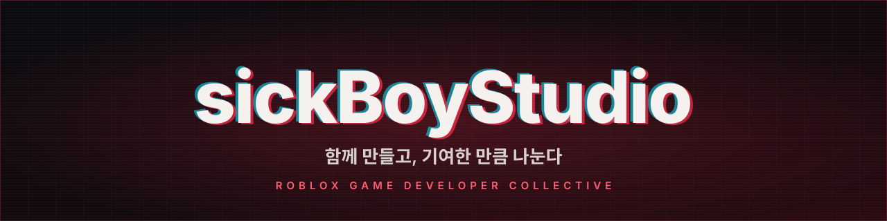
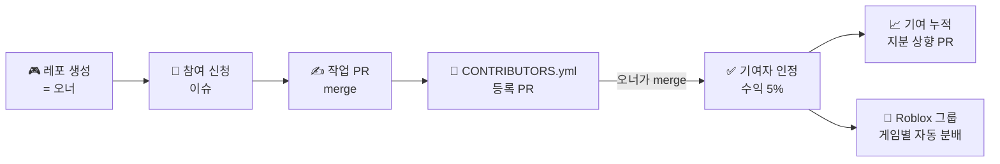

  

  <a href="https://github.com/sickBoyStudio/.github/discussions"><b>💬 소통창구</b></a> ·
  <a href="https://github.com/sickBoyStudio/.github/blob/main/guides/getting-started.md"><b>🌱 로블록스가 처음이라면</b></a> ·
  <a href="https://github.com/sickBoyStudio/.github/blob/main/CONTRIBUTING.md"><b>🤝 같이 만들기</b></a> ·
  <a href="https://github.com/sickBoyStudio/.github/blob/main/policies/revenue-share.md"><b>💰 수익 분배</b></a>

---

## 👋 sickBoyStudio

로블록스 게임을 만드는 **개발자들의 협업 스튜디오**입니다. 여기 있는 사람은 모두 개발자이고, 누구나 자기 게임 레포를 만들어 오너가 될 수 있습니다.

- 🎮 **레포를 만든 사람이 오너** — 게임의 방향과 최종 결정은 오너가 합니다.
- 🤝 **같이 만들고 싶으면 PR** — 기여자로 인정되는 순간 그 게임 **수익의 5%** 가 제안되고, 기여가 쌓이면 PR로 올립니다.
- 🔒 **열람은 자유, 가져가기는 허락** — 다른 레포의 코드와 에셋은 마음껏 보고 배우되, 가져다 쓰려면 허락을 받습니다.
- 🧾 **모든 약속은 기록으로** — 지분 장부는 각 레포의 `CONTRIBUTORS.yml`, 계약서는 PR입니다.
- 🌱 **처음이어도 괜찮아요** — 로블록스 게임을 처음 만드는 사람을 위한 소통창구를 열어 두었습니다.

## 🔁 같이 만드는 방법

## 💬 소통창구 — 로블록스가 처음인 사람도 환영

[**소통창구 바로가기 →**](https://github.com/sickBoyStudio/.github/discussions)

| | |
|---|---|
| 🙋 **질문 Q&A** | 스크립트, Studio, 퍼블리시, 수익화 무엇이든. 양식대로 쓰면 답이 빨라요 |
| 🤝 **팀원 모집** | 같이 만들 사람 찾기, 팀에 들어가고 싶을 때 |
| 🎮 **작품 자랑** | 작은 실험도 OK. 피드백 받기 |
| 👋 **자기소개·자유** | 처음 왔다면 인사부터 |

## 📚 규칙과 가이드

| | 문서 | 내용 |
|---|---|---|
| 🏛️ | [운영 규칙](https://github.com/sickBoyStudio/.github/blob/main/GOVERNANCE.md) | 역할, 가입·탈퇴, 레포 규칙, 의사결정, 분쟁 해결 |
| 🤝 | [공동제작 참여 가이드](https://github.com/sickBoyStudio/.github/blob/main/CONTRIBUTING.md) | PR로 기여자 등록하는 법, 지분 올리는 법 |
| 💰 | [수익 분배 규칙](https://github.com/sickBoyStudio/.github/blob/main/policies/revenue-share.md) | 첫 인정 5%, 상향 단계, 이탈, 지급 방법 |
| ✍️ | [기여자 약정](https://github.com/sickBoyStudio/.github/blob/main/policies/contributor-agreement.md) | 기여자 등록 때 동의하는 약정문 |
| 🔒 | [저작권과 사용 허가](https://github.com/sickBoyStudio/.github/blob/main/policies/copyright-and-licensing.md) | 참고는 자유, 가져가려면 허가 요청 |
| 🚨 | [저작권 침해 대응](https://github.com/sickBoyStudio/.github/blob/main/policies/infringement-response.md) | 조직 안·밖 침해, Roblox·GitHub 신고, 국내 절차 |
| ⚖️ | [법적 구조와 세금](https://github.com/sickBoyStudio/.github/blob/main/policies/legal-structure.md) | 조직의 법적 성격, 돈의 흐름, 세금, 성장 단계 |
| 📈 | [로블록스 수익구조 (2026.10)](https://github.com/sickBoyStudio/.github/blob/main/guides/roblox-revenue.md) | 수수료, DevEx 환율, Creator Rewards, 그룹 분배 |
| 🌱 | [로블록스 처음 만들어 보기](https://github.com/sickBoyStudio/.github/blob/main/guides/getting-started.md) | 4주 로드맵, 첫 스크립트, 공개, 첫 수익 |
| 🧭 | [행동강령](https://github.com/sickBoyStudio/.github/blob/main/CODE_OF_CONDUCT.md) | 소통창구에서 지킬 것 |

## 🔢 숫자로 보기

| | |
|---|---|
| 첫 기여자 인정 시 제안 지분 | **게임 수익의 5%** |
| 기여자가 직접 올릴 수 있는 폭 | 한 번에 **+5%p** |
| 기여자 지분 합계 기본 상한 | **50%** |
| 조직 수수료 | **0%** |
| 게임 패스·개발자 상품 개발자 몫 | 판매가의 **70%** |
| DevEx 환율 (일반 / 미국 18+) | **$0.0038 / $0.0054** per Robux |
| DevEx 최소 금액 | **30,000 Robux** (약 $114) |

로블록스 수치는 2026-10-15 기준입니다. 규칙 v1.0 · 2026-10-15 시행 · 법률·세무 자문이 아닙니다.
